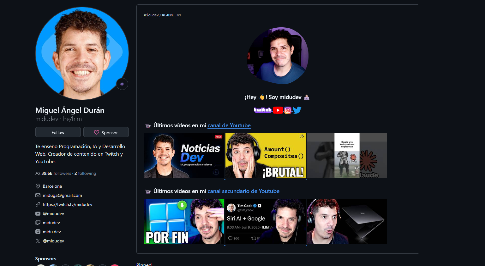
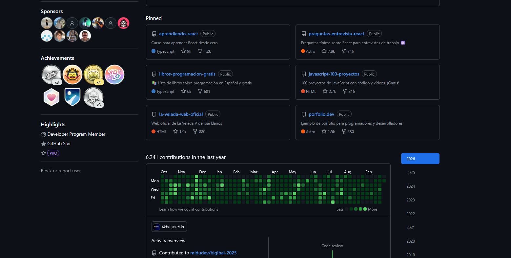

# Planificación de mi portafolio

Este documento reúne cómo planifiqué y construí mi portafolio: el repositorio que elegí y por qué, el ejemplo que analicé, el trabajo que destaco y las buenas prácticas que aplico.

**Autor:** Álvaro Joaquín Leal Moraga · Bootcamp Full Stack Python, Talento Digital para Chile · [Volver al perfil](README.md)

---

## 1. Repositorio elegido: GitHub

Mi portafolio es de desarrollo de software, y GitHub es el lugar donde ese trabajo vive naturalmente: el código, su historial de cambios y su documentación quedan en un mismo sitio, a la vista de cualquier empresa que quiera revisarlo.

| Característica | Por qué me sirve |
|---|---|
| Control de versiones con Git | El historial de commits muestra cómo evolucionó cada proyecto y la constancia del trabajo. |
| README de perfil | La página principal de mi perfil me presenta, muestra mis tecnologías y destaca mis proyectos. |
| README por proyecto | Cada repositorio explica qué hace, cómo instalarlo y muestra capturas. |
| Repositorios fijados | Los proyectos más importantes son lo primero que se ve. |
| GitHub Pages | Publica gratis sitios estáticos; mi proyecto [Viajes Chile](https://alvarolealmoraga-design.github.io/viajes-chile/) está en línea así. |
| Gratuito y estándar en la industria | Los repositorios públicos no tienen costo y es lo que más revisan los equipos técnicos. |

**Otras alternativas consideradas:**
- **Heroku:** sirve para publicar aplicaciones Django, pero desde noviembre de 2022 [no tiene planes gratuitos](https://help.heroku.com/RSBRUH58/removal-of-heroku-free-product-plans-faq).
- **Stack Overflow:** muestra participación en preguntas y respuestas, pero no proyectos completos.
- **YouTube:** útil para demos en video, pero no muestra el código.

Las uso como complemento, no como repositorio principal.

---

## 2. Ejemplo analizado: midudev

Perfil de Miguel Ángel Durán, desarrollador y divulgador de programación en español: [github.com/midudev](https://github.com/midudev)

**Lo que me gusta:**
1. **Presentación cercana y visual:** foto, saludo directo e íconos enlazados a sus redes. En segundos se entiende quién es y dónde encontrarlo.
2. **Proyectos fijados bien descritos:** cada uno con una frase, su lenguaje principal y sus estrellas, más los datos de contacto en la barra lateral.

**Lo que se puede mejorar:**
1. **El README está centrado en videos, no en proyectos:** no hay una sección de tecnologías, así que un reclutador no ve de un vistazo qué domina.
2. **Falta un «sobre mí»:** no cuenta su trayectoria ni en qué le interesa colaborar.

**Cómo lo apliqué en mi perfil:** tomé el saludo directo, los enlaces de contacto y los proyectos fijados con descripción. Para mejorar los puntos débiles, agregué las secciones «Sobre mí», «Qué busco» e «Intereses», insignias de tecnologías y una tabla de proyectos que explica qué hace cada uno.

---

## 3. Trabajo destacado: Arriendos Chile

[github.com/alvarolealmoraga-design/arriendos-chile](https://github.com/alvarolealmoraga-design/arriendos-chile)

Sitio web en Django y PostgreSQL para publicar y arrendar inmuebles. Lo elegí porque es mi proyecto más completo: reúne en un solo sitio funcional todo lo aprendido en el módulo de acceso a datos.

- Modelo relacional con claves foráneas entre regiones, comunas, tipos de inmueble, inmuebles y usuarios.
- CRUD completo con el ORM de Django y filtros por región, comuna, tipo y precio.
- Registro, inicio de sesión, perfiles y permisos por grupo.
- Las 16 regiones y 346 comunas de Chile cargadas con migraciones y `loaddata`.
- 35 pruebas automáticas.

**Mejoras incorporadas al publicarlo:**

| Mejora | Detalle |
|---|---|
| Credenciales protegidas | La contraseña de la base de datos y la clave secreta se leen desde un archivo `.env` que no se sube al repositorio. |
| `.gitignore` | Excluye el entorno virtual, archivos temporales y el `.env`. |
| README profesional | Funcionalidades, tecnologías, instalación paso a paso, usuarios de prueba y capturas. |
| Diseño adaptable | El sitio se ve correctamente en celulares. |

---

## 4. Buenas prácticas que aplico

| Buena práctica | Estado |
|---|---|
| Calidad antes que cantidad: fijar solo los mejores proyectos | ✅ Fijados Arriendos Chile y Viajes Chile |
| Un README claro en cada proyecto | ✅ Ambos proyectos tienen README con instrucciones y capturas |
| Nunca publicar datos sensibles | ✅ `.env` y `.gitignore` en Arriendos Chile; teléfono fuera del perfil público |
| Commits con mensajes descriptivos | ✅ |
| Nombres de repositorios descriptivos y estructura ordenada | ✅ |
| Proyectos que se puedan ver en línea | ✅ Viajes Chile en GitHub Pages · 🔜 Arriendos Chile en un hosting para Django |
| Perfil completo y coherente con mi CV y LinkedIn | ✅ Nombre real, foto, bio, ubicación y enlaces |
| Mantenerlo actualizado e incorporar retroalimentación | 🔄 Continuo |
| Cuidar la redacción y la ortografía | ✅ |

---

## 5. Historial de mejoras del portafolio

- Perfil completado con nombre real, fotografía, bio, ubicación, correo y LinkedIn.
- README de perfil con «Sobre mí», «Qué busco», «Intereses», tecnologías, proyectos y contacto.
- Proyectos Arriendos Chile y Viajes Chile fijados en el perfil.
- Arriendos Chile publicado con credenciales protegidas, `.gitignore` y README completo.
- Enlace directo a la versión en línea de Viajes Chile.
